# Livrables jour 4 : PCE, Processus Créatif Éthique

| Livrable | Fichier |
|---|---|
| Pitch écrit | [Pitch_PCE.pdf](Pitch_PCE.pdf) |
| Business plan | [Business_Plan_PCE.xlsx](Business_Plan_PCE.xlsx) (onglet Hypothèses inclus) |
| Prototype | [Prototype_PCE.html](Prototype_PCE.html) : à télécharger puis ouvrir dans Chrome ou Edge, sans connexion |

## Prototype

Site complet en un seul fichier. Les données sont enregistrées dans le navigateur. La certification est délivrée à une **entreprise** (indépendant, studio, agence), identifiée par son **SIRET**, pour un an.

- **Côté public** : accueil avec moteur « Dernières œuvres et entreprises vérifiées », critères et tarifs avec estimateur du coût annuel, page Vérifier (numéro d'œuvre, numéro d'entreprise, SIRET ou nom), registre des entreprises certifiées, registre des œuvres, Charte de transparence, FAQ.
- **Dépôt du dossier de l'entreprise**, en 5 étapes : SIRET (contrôle de la clé, refus d'un SIRET déjà enregistré) et identité de l'entreprise, processus créatif, Kbis + portfolio (1 à 3 œuvres) + justificatifs, Charte signée par le représentant, récapitulatif et règlement de la certification annuelle. Aucun test d'IA au dépôt.
- **Espace client** : l'entreprise se connecte avec son SIRET ou son numéro de dossier et son e-mail. Elle voit sa certification et sa validité, ses œuvres certifiées (sceau et QR code téléchargeables), peut déclarer une nouvelle œuvre et télécharger sa charte signée.
- **Accès commission** (pied de page) : tableau de bord, dossiers à traiter, base des entreprises, base des œuvres, double vérification (analyse IA des fichiers, puis contrôle humain, audit terrain si besoin), décision, export CSV.

### Tarifs

La certification est annuelle et sur mesure, à partir de 108 € HT par an. Son coût dépend du nombre de créations à certifier, de la taille de la structure, de l'ampleur du processus créatif et de l'étude du dossier. La vérification est gratuite.

### Accueil
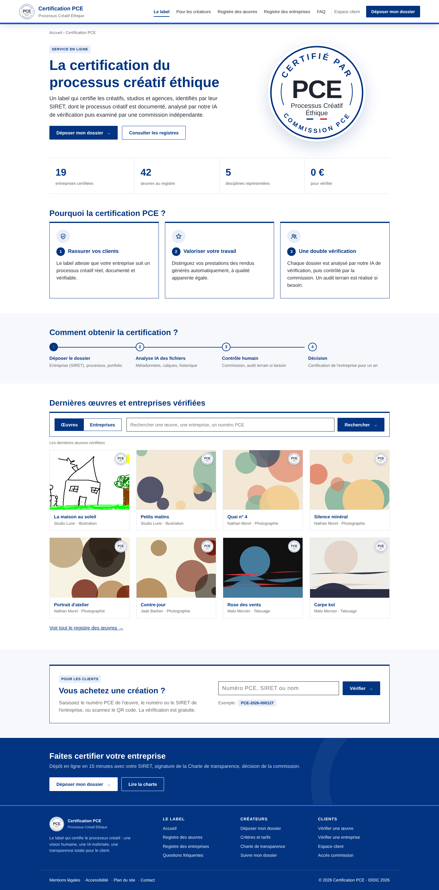

### Dépôt : l'entreprise et son SIRET
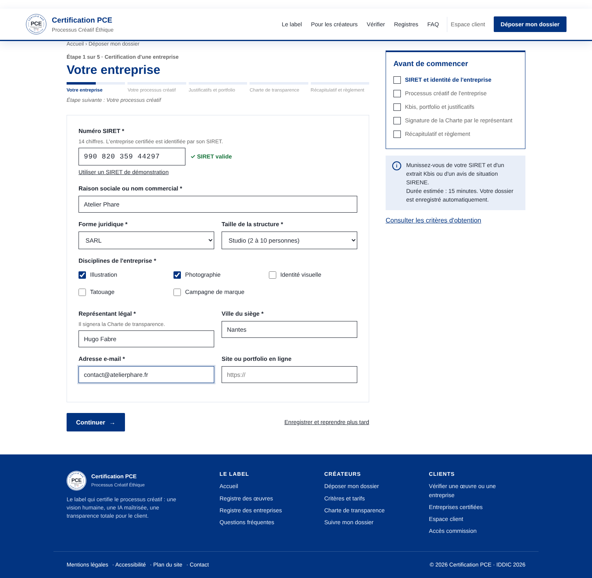

### Dépôt : Kbis, portfolio et justificatifs
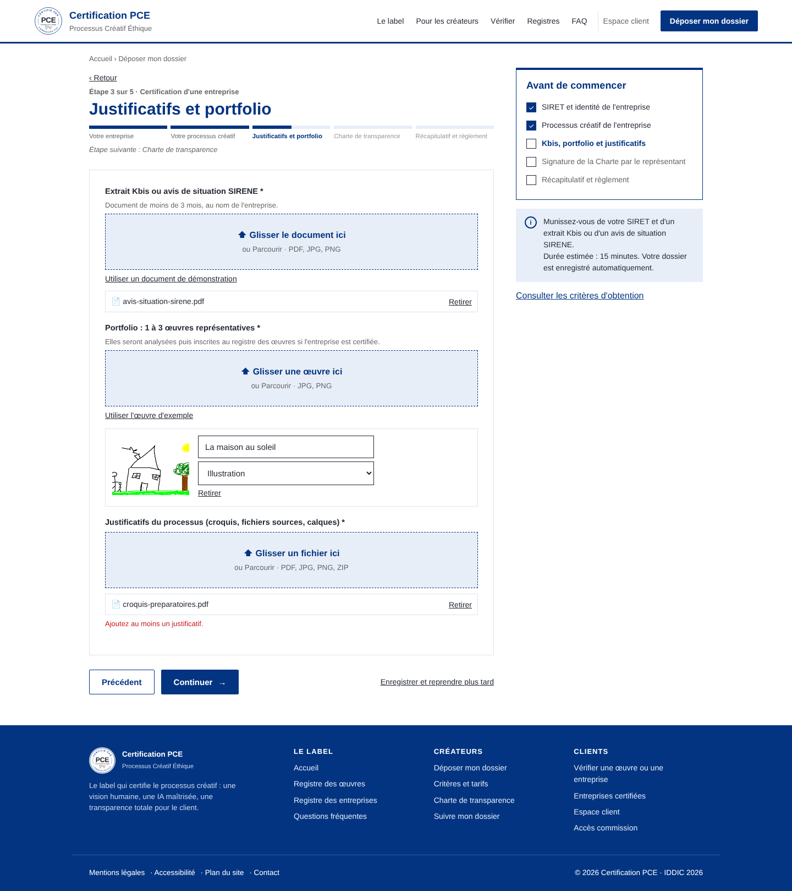

### Dépôt : charte signée par le représentant
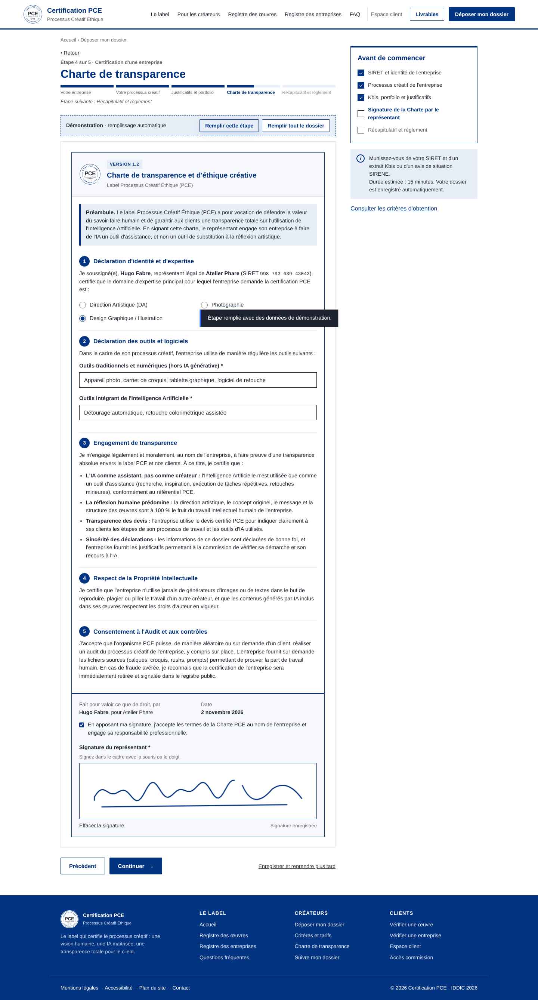

### Dépôt : récapitulatif
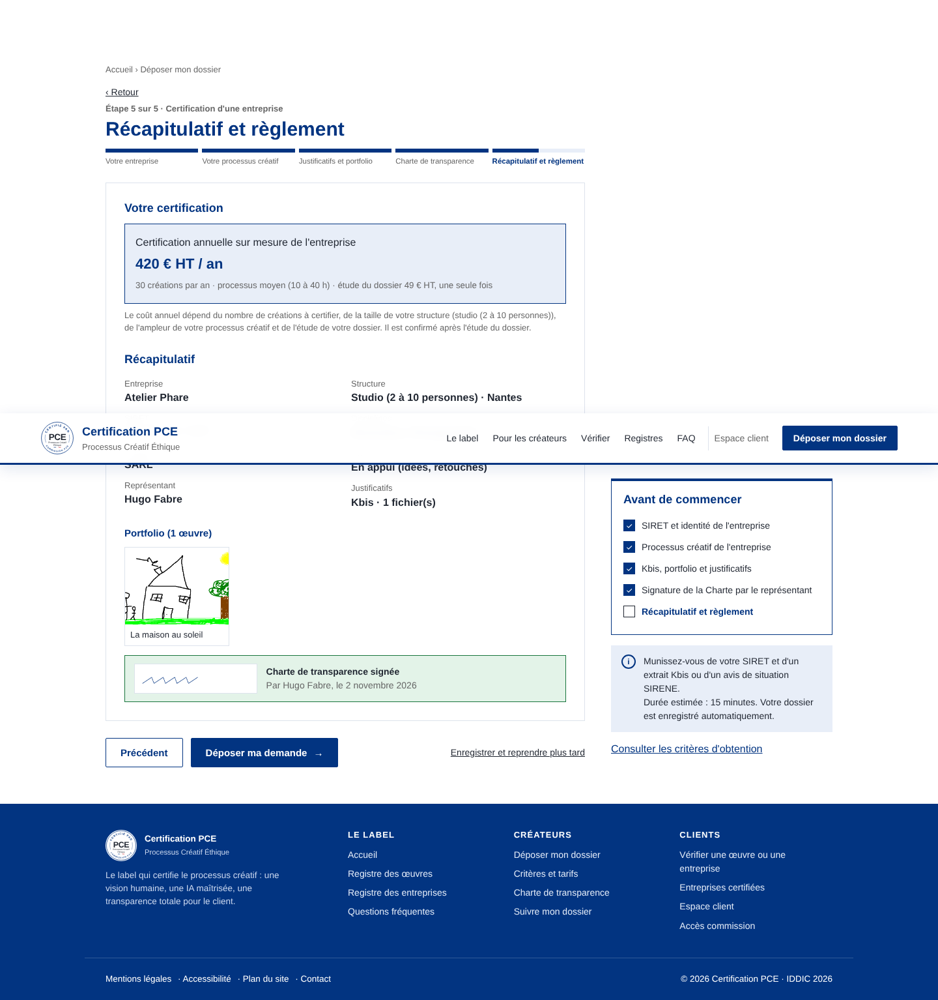

### Confirmation
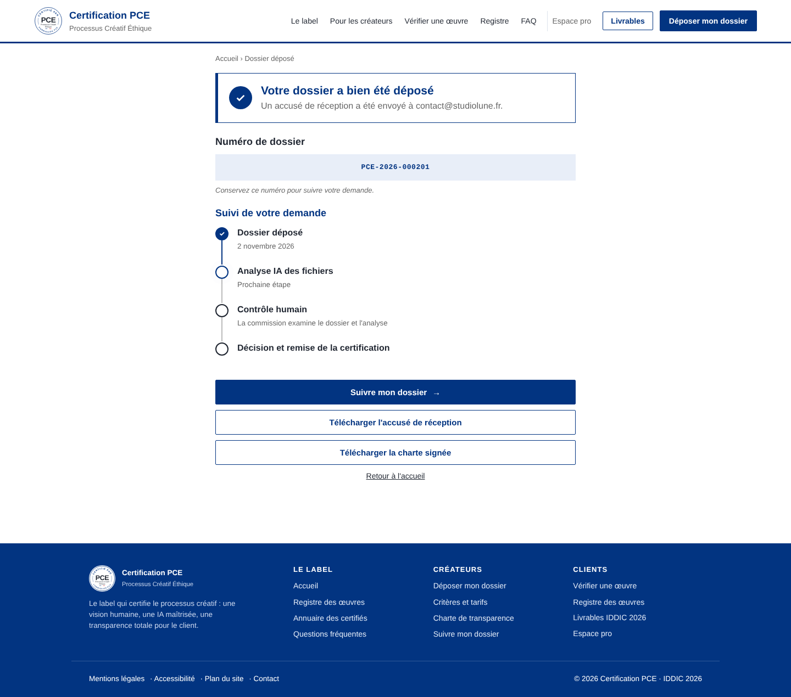

### Registre des entreprises certifiées
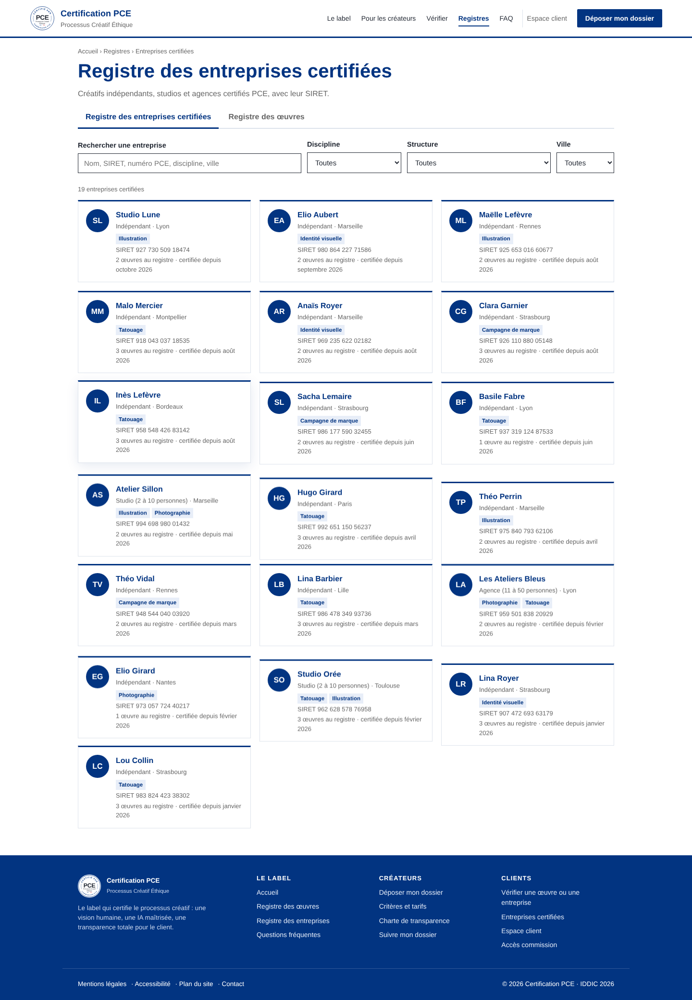

### Fiche d'une entreprise certifiée
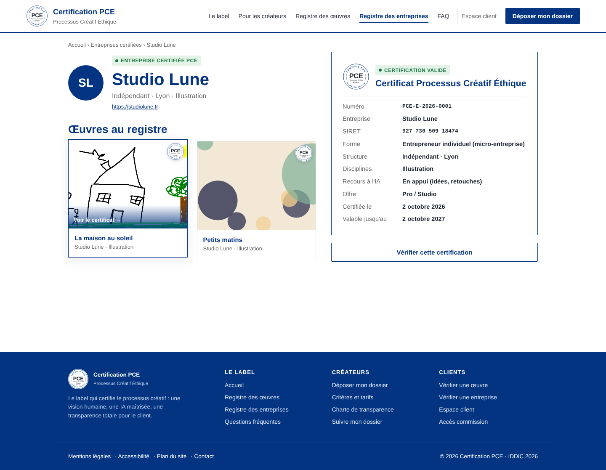

### Registre des œuvres
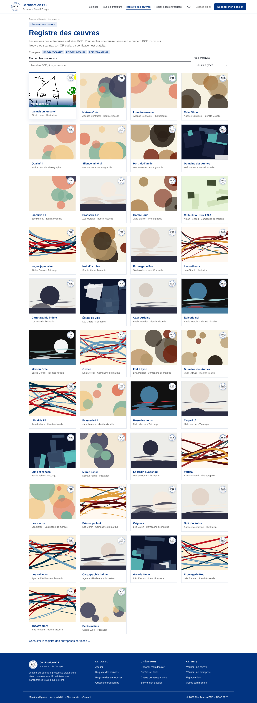

### Vérifier une œuvre ou une entreprise
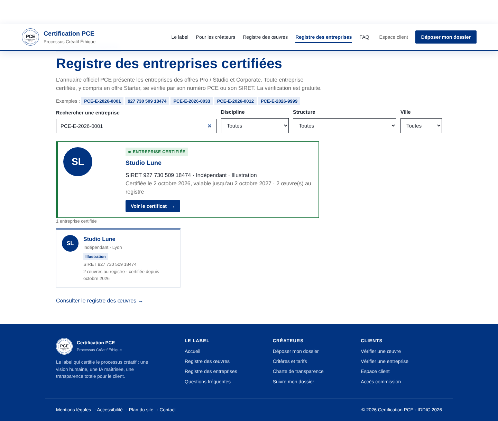

### Espace client
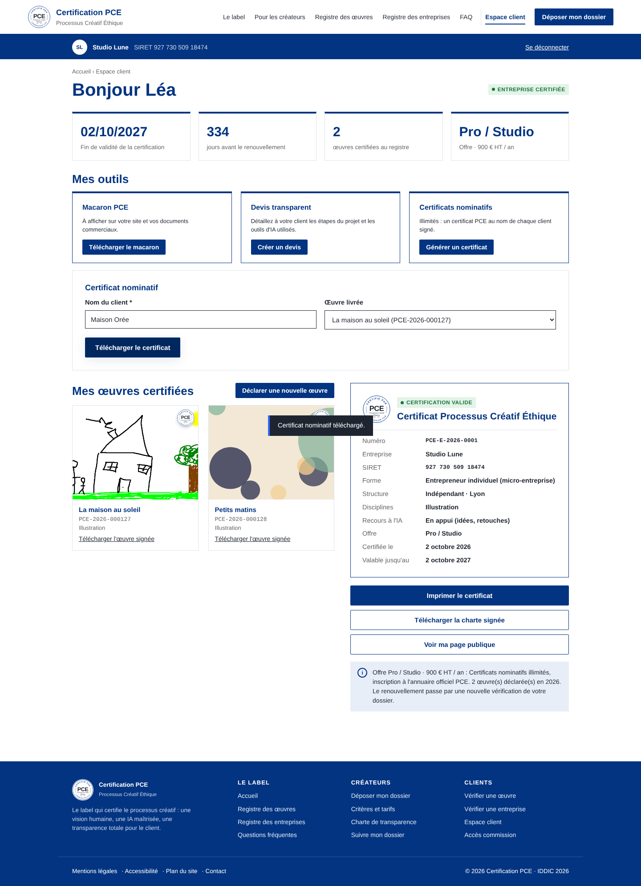

### Accès commission
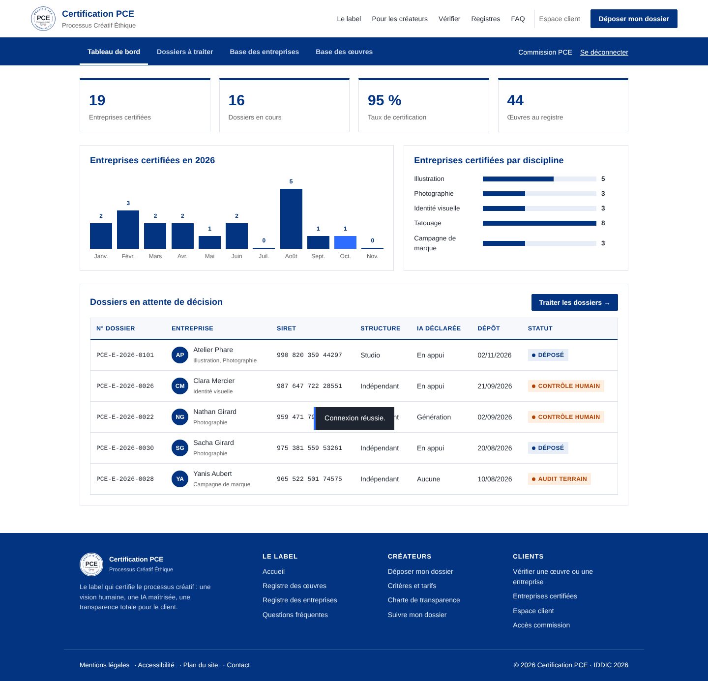

### Commission : dossier d'une entreprise
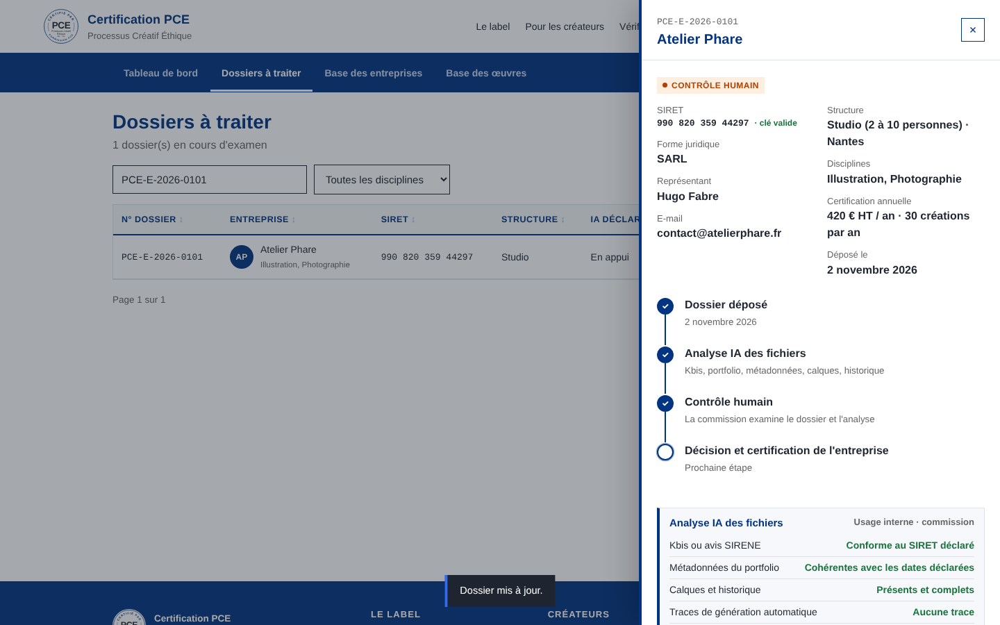

### Mobile
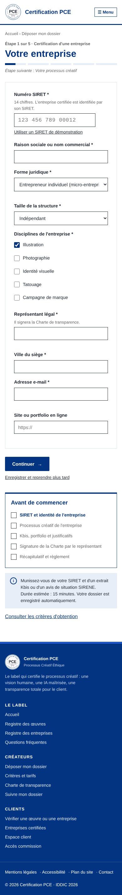
