# Livrables jour 4 : PCE, Processus Créatif Éthique

| Livrable | Fichier |
|---|---|
| Pitch écrit | [Pitch_PCE.pdf](Pitch_PCE.pdf) |
| Business plan | [Business_Plan_PCE.xlsx](Business_Plan_PCE.xlsx) (onglet Hypothèses inclus) |
| Prototype | [Prototype_PCE.html](Prototype_PCE.html) : à télécharger puis ouvrir dans Chrome ou Edge, sans connexion |

## Prototype

Site complet en un seul fichier. Les données sont enregistrées dans le navigateur.

- **Côté public** : accueil, critères et tarifs avec estimateur d'abonnement, vérification d'une œuvre (rubrique clients), registre des œuvres certifiées, Charte de transparence, FAQ.
- **Parcours créateur** : dépôt du dossier en 5 étapes, calcul du dosage humain et IA (seuil 10 %), Charte de transparence (version 1.1) remplie et signée en ligne, obligatoire, abonnement sur mesure, devis client transparent, accusé de réception, suivi, certificat, œuvre signée avec sceau et QR code.
- **Bouton Livrables** dans l'en-tête : téléchargement du pitch, du business plan et du prototype.
- **Espace pro** (connexion de démonstration pré-remplie) : tableau de bord, dossiers à traiter, base des œuvres avec recherche, filtres, tri, fiche détaillée avec charte signée, décision de la commission, export CSV.

### Tarifs

L'abonnement est sur mesure, à partir de 9 € HT par mois. Son tarif dépend du nombre de créations à certifier, de la taille de la structure, de l'ampleur du processus créatif et de l'étude du dossier. La certification à l'unité dépend de l'œuvre, de 25 € à 149 € HT. La vérification est gratuite.

### Accueil

### Dépôt : processus créatif

### Dépôt : signature de la charte
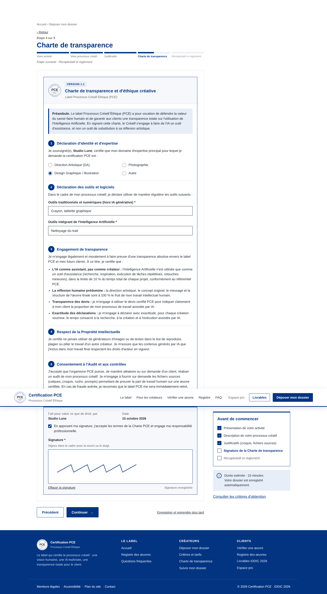

### Dépôt : abonnement, devis et règlement
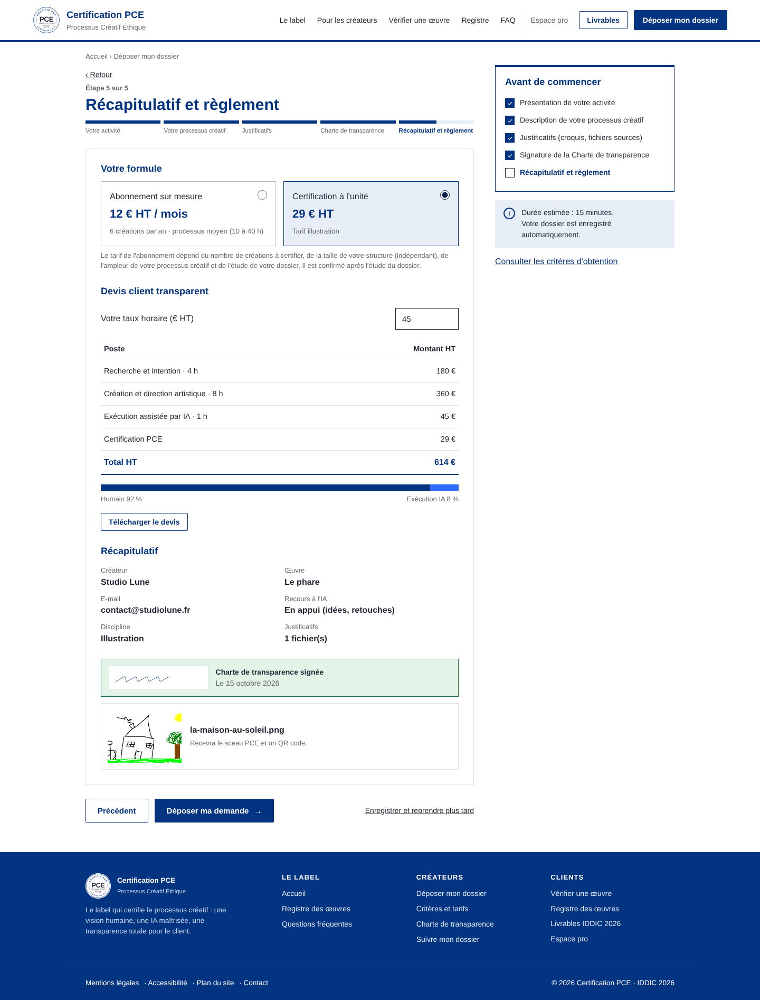

### Tarifs et estimateur d'abonnement
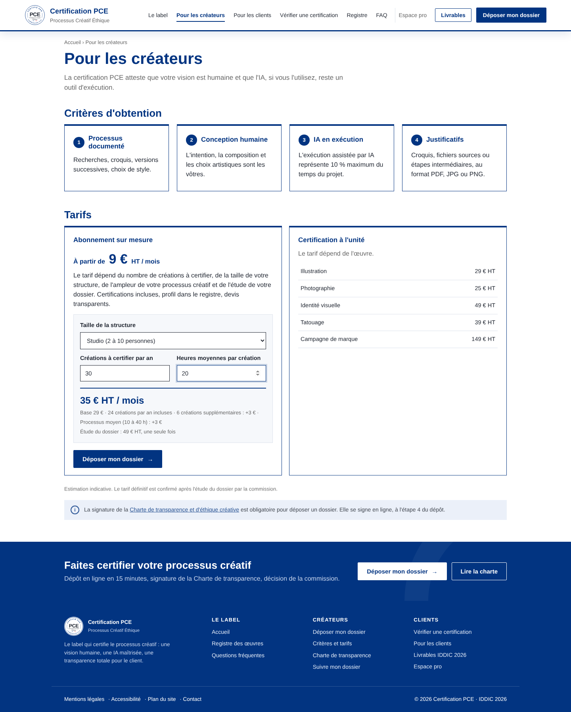

### Confirmation
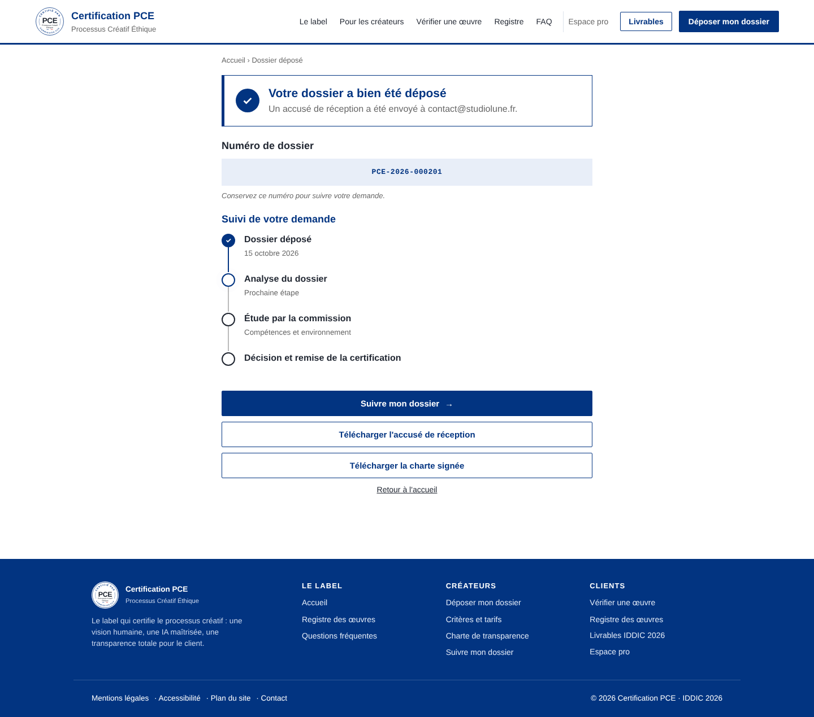

### Certificat et œuvre signée
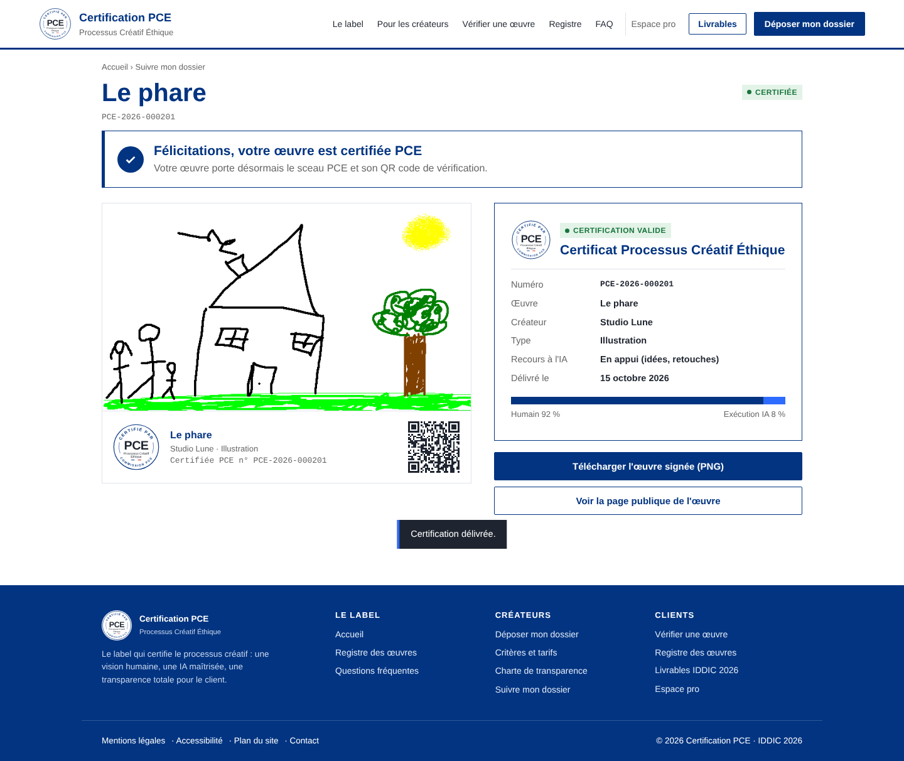

### Vérifier une œuvre
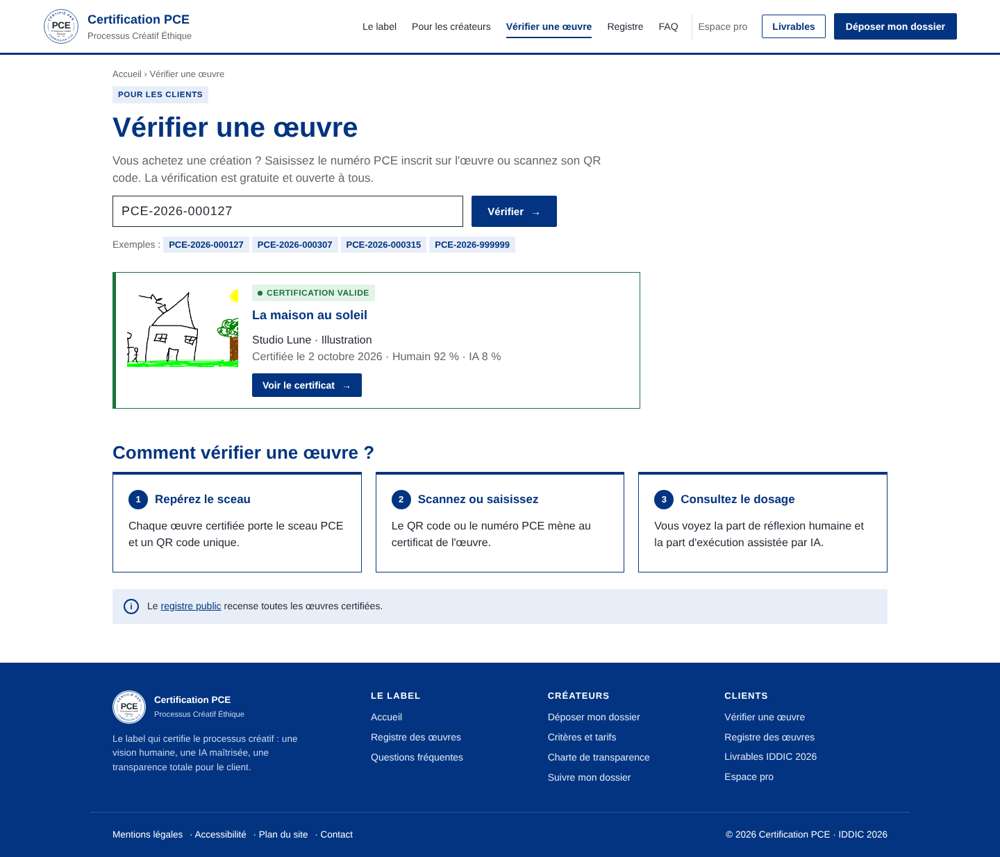

### Registre public
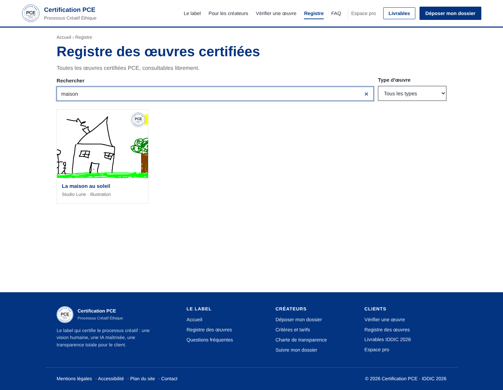

### Espace pro : tableau de bord
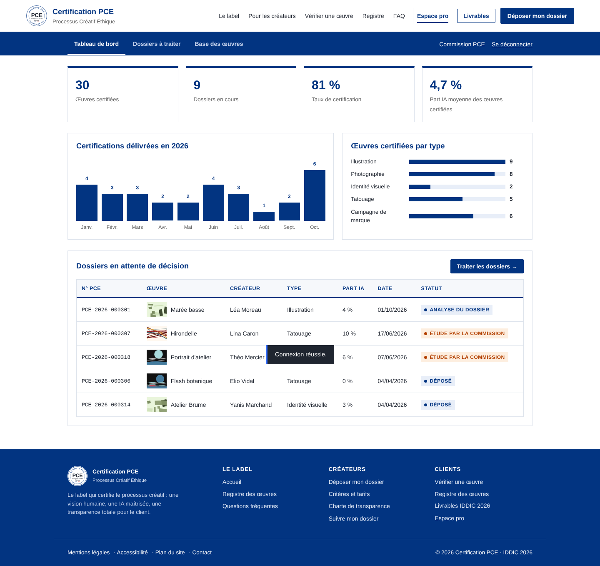

### Espace pro : base des œuvres
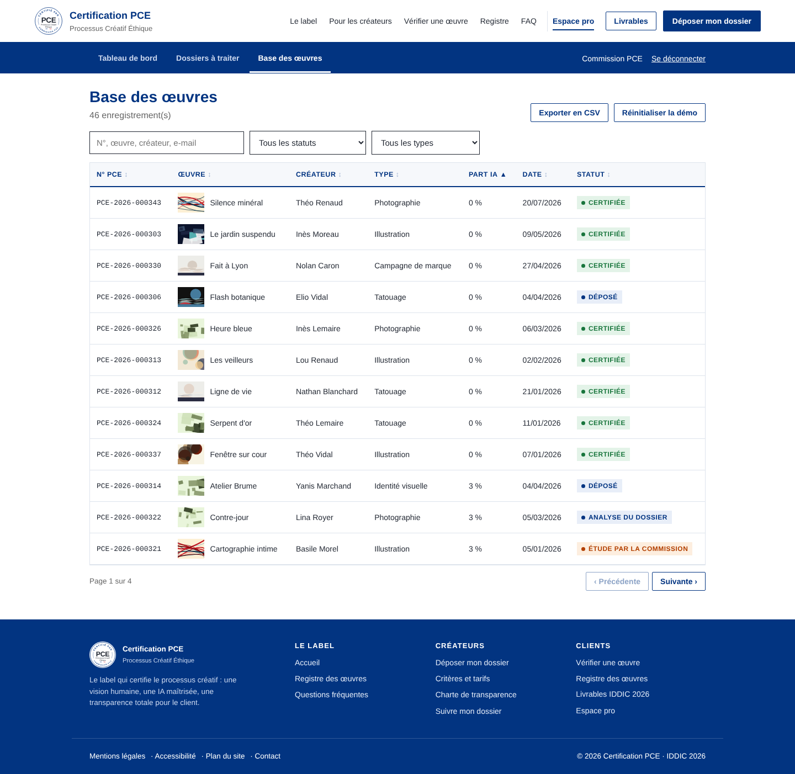

### Espace pro : fiche dossier
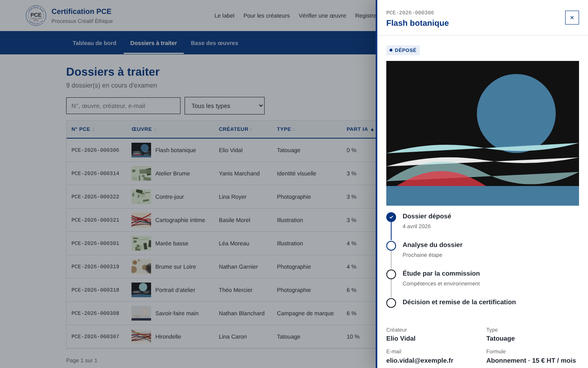

### Mobile
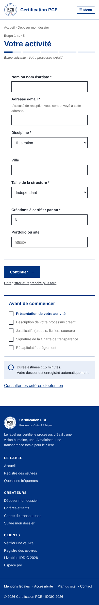
