# Livrables jour 4 : PCE, Processus Créatif Éthique

| Livrable | Fichier |
|---|---|
| Pitch écrit | [Pitch_PCE.pdf](Pitch_PCE.pdf) |
| Présentation | [Presentation_PCE.pdf](Presentation_PCE.pdf) |
| Business plan | [Business_Plan_PCE.xlsx](Business_Plan_PCE.xlsx) |
| Prototype | [Prototype_PCE.html](Prototype_PCE.html) : à télécharger puis ouvrir dans Chrome ou Edge, sans connexion |

## Prototype

Site complet en un seul fichier. Les données sont enregistrées dans le navigateur.

- **Côté public** : accueil, critères et tarifs, page clients, vérification d'une certification, registre des œuvres certifiées, FAQ.
- **Parcours créateur** : dépôt du dossier en 4 étapes, calcul du dosage humain et IA (seuil 10 %), devis client transparent, règlement, accusé de réception, suivi du dossier, certificat, œuvre signée avec sceau et QR code (téléchargeable en PNG).
- **Espace pro** (connexion de démonstration pré-remplie) : tableau de bord, dossiers à traiter, base des œuvres avec recherche, filtres, tri, fiche détaillée, décision de la commission, export CSV.

### Accueil
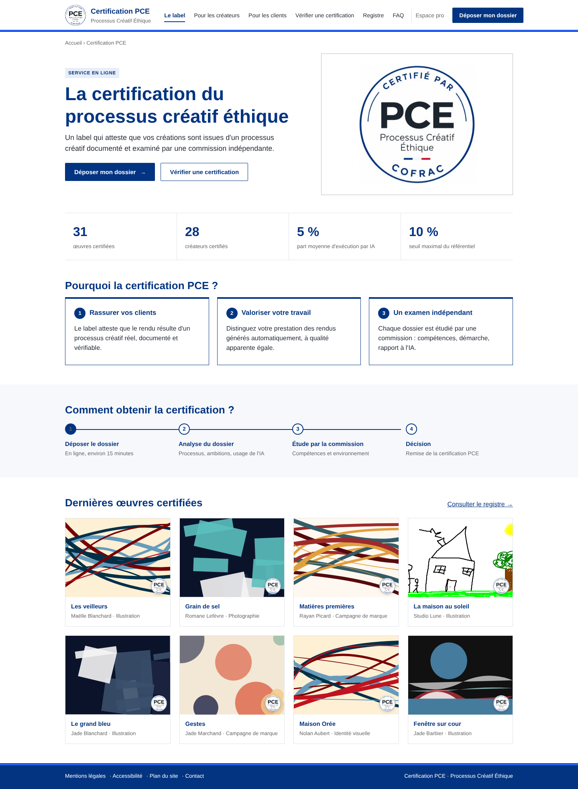

### Dépôt : processus créatif
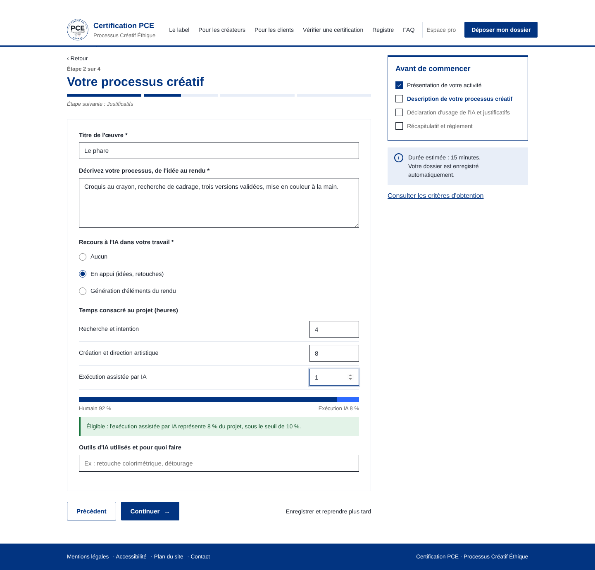

### Dépôt : devis et règlement
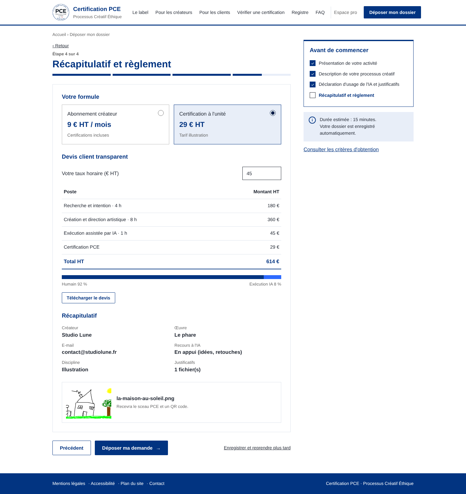

### Confirmation
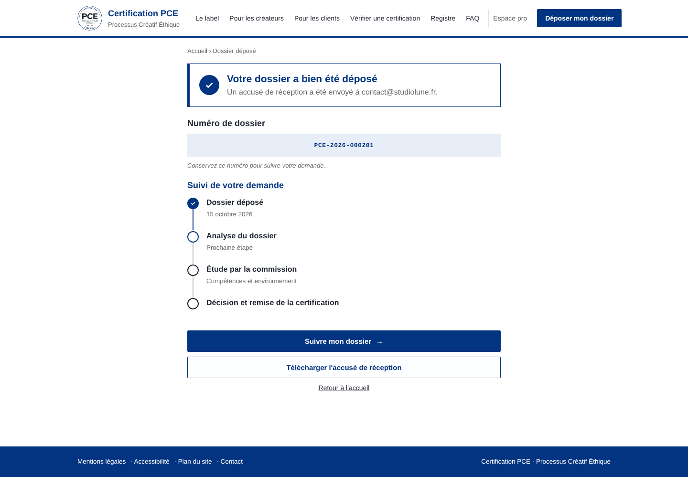

### Certificat et œuvre signée
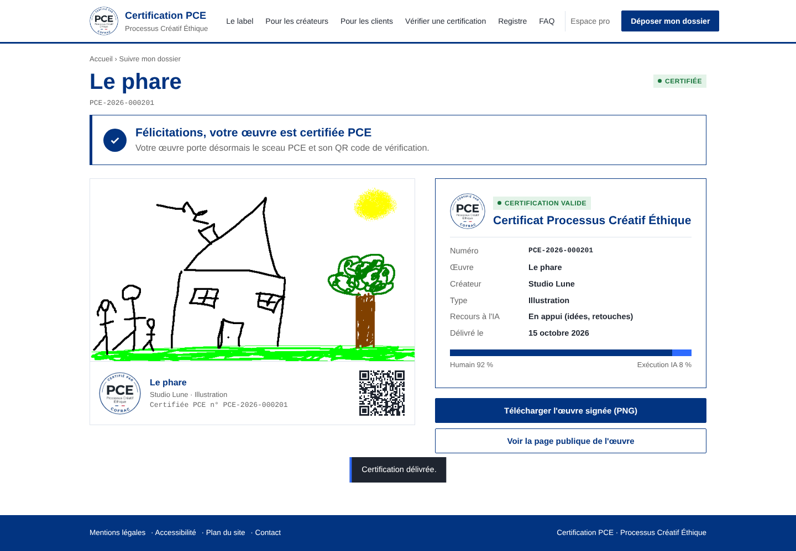

### Vérification
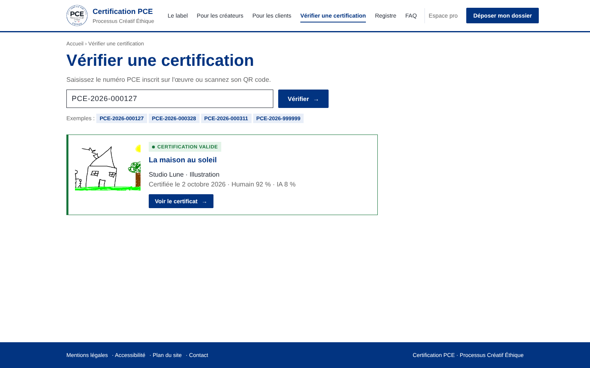

### Registre public
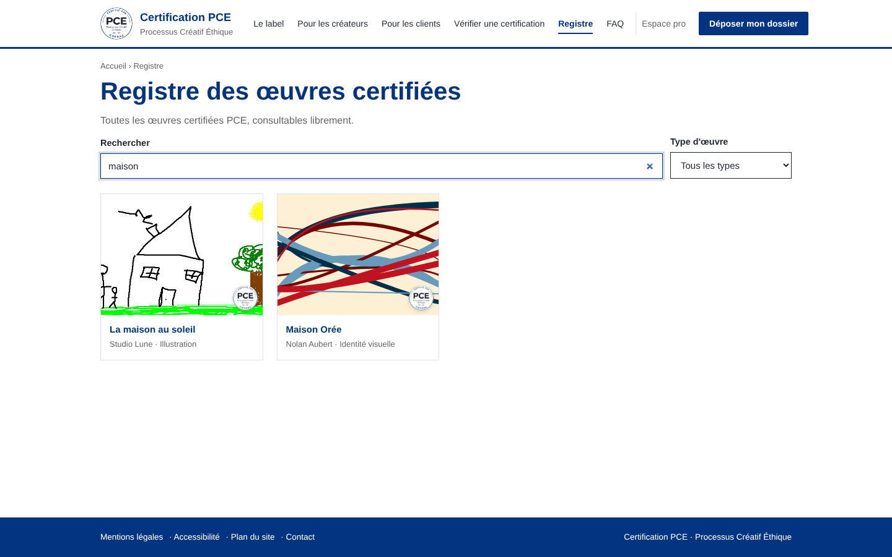

### Espace pro : tableau de bord
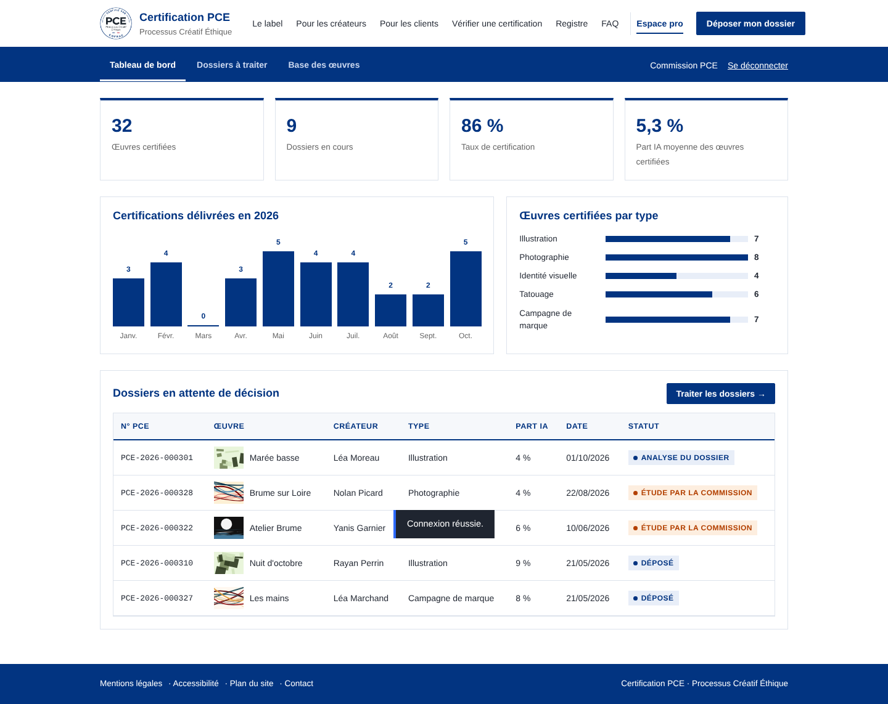

### Espace pro : base des œuvres
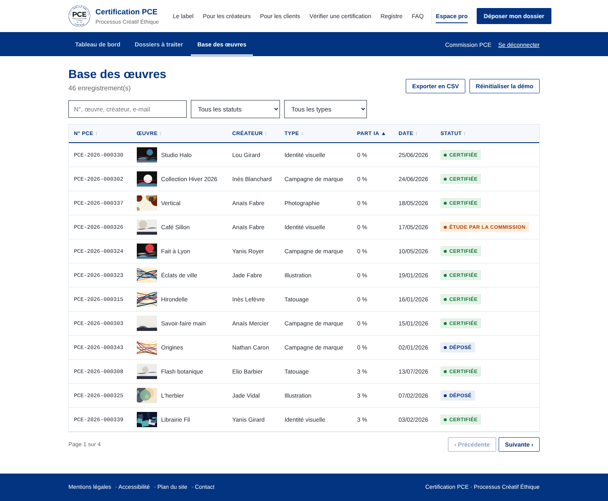

### Espace pro : fiche dossier
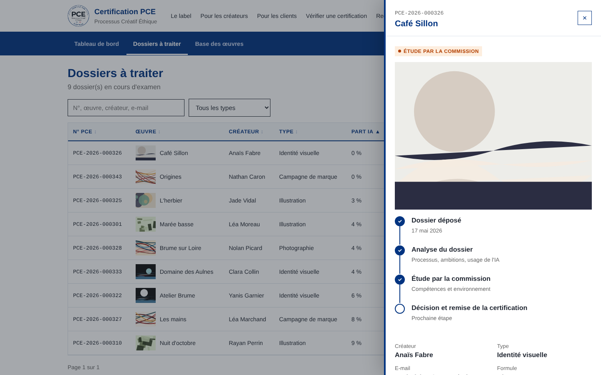

### Mobile
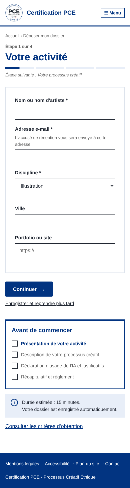
